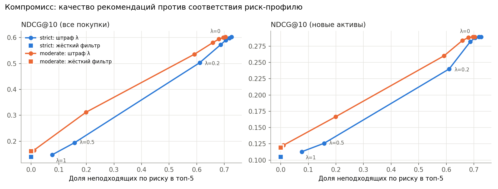
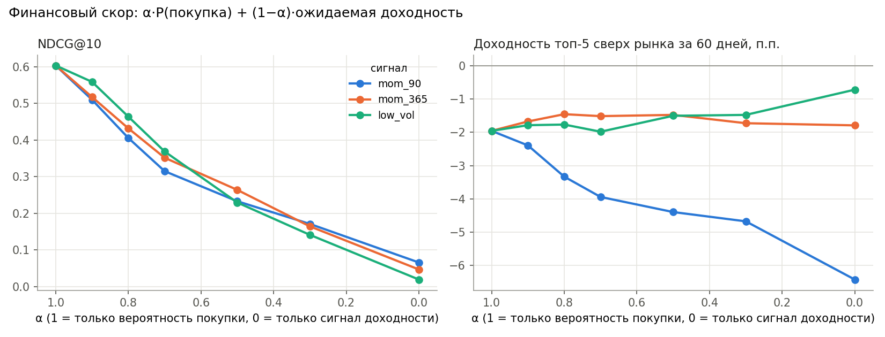
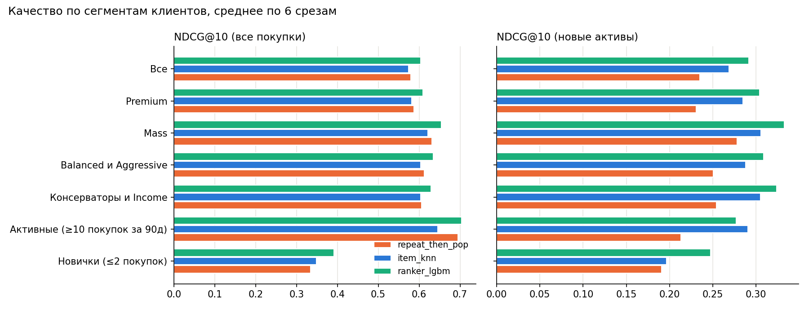

# FAR-Trans: рекомендации инвестиционных продуктов

Для клиента на дату `t` ранжируем доступные активы так, чтобы наверху были те, что он купит
в ближайшие 60 дней, при этом не нарушая его риск-профиль. Качество меряем тремя группами метрик:
угадывание поведения, финансовый результат, пригодность (suitability).

Данные: [FAR-Trans](https://doi.org/10.5525/gla.researchdata.1658) (Sanz-Cruzado, Droukas, McCreadie, 2024), CC BY 4.0.
Положить распакованный архив в `data/raw/FAR-Trans/`.

## Структура

```
configs/base.yaml        даты срезов, окна, шкала риска
src/farrec/data.py       загрузка, очистка, as-of выборки
src/farrec/portfolio.py  восстановление портфелей
src/farrec/splits.py     срезы по времени, таргет, train/valid/test
src/farrec/risk.py       уровни риска активов 1..7 (по волатильности, как SRRI)
src/farrec/metrics.py    ranking / financial / suitability
src/farrec/baselines.py  бейзлайны
src/farrec/cf.py         Item-kNN и ALS
src/farrec/candidates.py уровень 1: генерация кандидатов
src/farrec/features.py   признаки клиента, актива и пары
src/farrec/ranker.py     уровень 2: LightGBM / CatBoost ранкер
src/farrec/evaluate.py   единый протокол оценки
scripts/run_baselines.py бейзлайны на 12 срезах -> reports/baselines_*.csv
scripts/tune_cf.py       подбор параметров kNN/ALS на валидации
scripts/run_ranker.py    ранкер против бейзлайнов на 6 срезах
tests/                   тесты на утечки
```

```
pip install -r requirements.txt
python scripts/run_baselines.py
pytest -q
```

## Схема эксперимента

* Срезы: первое число каждого месяца, 2020-01 … 2022-09.
* Признаки и кандидаты только из `(-inf, t)`, таргет: покупки в `[t, t+60d)`.
* Test = последний срез (2022-09-01), valid = последний срез, чьё окно таргета заканчивается до test
  (2022-07-01), train = срезы, чьё окно заканчивается до valid. Без зазора метки train пересекались бы с периодом оценки.
* В оценке только клиенты, купившие хоть что-то в окне таргета.

## Особенности данных (найдено на EDA)

| Что | Как обработано |
|---|---|
| 2018-01-02: ~35.7k «покупок» за день (обычно ~50–300) — выгрузка стартовых портфелей | флаг `isSnapshot`: идут в портфель, но не считаются покупками |
| `transactionID` не уникален (~29k повторов) — совместные счета, одна сделка на нескольких клиентов | дедупликация только по полной строке |
| Риск-профиль бывает `Predicted_*` | префикс снимается, отдельный флаг `riskPredicted` |
| Профиль клиента меняется во времени | берётся последний известный до среза |
| Продажи больше видимых покупок (история до 2018 не видна) | позиции обрезаются по нулю |
| 89% покупок — акции | учитывать при интерпретации популярности |

## Результаты бейзлайнов

Backtest: среднее по 12 срезам (2021-10 … 2022-09), в скобках std. `_new` = уже купленное скрыто,
таргет только первые покупки актива. Параметры kNN и ALS подобраны на валидационных срезах
(`scripts/tune_cf.py`), тестовый срез при подборе не использовался.

| method | NDCG@10 | HR@10 | NDCG@10_new | HR@10_new | Ret@5 (60д) | Unsuit@5 | Cov@10 |
|---|---|---|---|---|---|---|---|
| random | 0.002 | 0.01 | 0.003 | 0.01 | −0.4% | 0.36 | 0.01 |
| pop_30d | 0.308 (0.070) | 0.64 | 0.243 | 0.48 | −1.0% (8.7%) | 0.62 | 0.01 |
| pop_segment_90d | 0.261 | 0.61 | 0.188 | 0.43 | −1.9% | 0.56 | 0.02 |
| momentum_90d | 0.017 | 0.06 | 0.016 | 0.05 | −5.6% (19%) | 0.72 | 0.01 |
| repeat_then_pop | **0.546** (0.045) | **0.81** | 0.239 | 0.47 | −1.3% | 0.66 | 0.26 |
| item_knn | 0.539 (0.050) | 0.81 | **0.281** (0.037) | **0.53** | −1.3% | 0.68 | 0.19 |
| als | 0.540 (0.041) | 0.80 | 0.202 | 0.38 | −1.4% | 0.67 | 0.26 |

Наблюдения:
1. **78.5% покупок в окне таргета — повторные.** По общему NDCG простое «свои покупки + популярность»
   не хуже kNN и ALS. Реальную разницу между моделями видно только на новых активах: там Item-kNN
   лучше популярности на 16% (0.281 против 0.243), а ALS даже после подбора хуже популярности.
2. **Один тестовый срез врёт.** На срезе 2022-09 популярность даёт +8.1% за 60 дней,
   а в среднем по 12 срезам −1.0% при std 8.7%. Финансовые метрики имеет смысл смотреть только по многим срезам.
3. **Ни один бейзлайн не обгоняет рынок** (Excess@5 около нуля или отрицательный). Momentum хуже всех:
   он выбирает неликвидные бумаги с резкими скачками цены.
4. **76% реальных покупок нарушают наивное соответствие «профиль → макс. уровень»**: почти все акции
   получают уровень 6–7 по волатильности. Пороги нужно калибровать (или считать риск на уровне портфеля).

## Двухуровневая модель

**Уровень 1, кандидаты** ([candidates.py](src/farrec/candidates.py)): объединение топ-50 из четырёх источников
(свои прошлые покупки, Item-kNN, ALS, популярность), в среднем ~85 активов на клиента.

| топ-N из источника | кандидатов на клиента | полнота (все покупки) | полнота (новые активы) |
|---|---|---|---|
| 20 | 35 | 88–89% | 54–67% |
| **50** | **85** | **97%** | **84–89%** |
| 100 | 155 | 99% | 95–97% |

**Уровень 2, ранжирование** ([ranker.py](src/farrec/ranker.py)): LightGBM lambdarank, группа = (срез, клиент),
68 признаков ([features.py](src/farrec/features.py)): клиент (активность, портфель, профиль), актив (доходности,
волатильность, просадка, популярность и её тренд), пара (держит ли, сколько раз покупал, доля сектора в портфеле,
превышение риска, популярность в риск-сегменте, скоры и ранги источников).
Для каждого среза оценки модель переобучается только на прошлых срезах: valid = последний срез с окном таргета
до даты оценки (early stopping), train = 12 срезов с окном таргета до valid.

Среднее по 6 срезам (2022-04 … 2022-09), модель лучше бейзлайнов **на каждом** срезе:

| method | NDCG@10 | HR@10 | NDCG@10_new | HR@10_new |
|---|---|---|---|---|
| pop_30d | 0.335 | 0.66 | 0.239 | 0.45 |
| repeat_then_pop | 0.580 | 0.83 | 0.235 | 0.44 |
| item_knn | 0.574 | 0.83 | 0.269 | 0.49 |
| als | 0.570 | 0.82 | 0.188 | 0.34 |
| **ranker_lgbm** | **0.603** | **0.85** | **0.289** | **0.53** |

Самые важные признаки (gain): ранги источников (ALS 29%, repeat 16%, kNN 13%), затем отрасль актива и доля
актива в портфеле клиента. ALS слаб как самостоятельный рекомендатель, но его ранг самый информативный признак:
он хорошо дополняет остальные источники.

## Риск-профиль: компромисс между качеством и соответствием

Уровень риска актива 1..7 считается по годовой волатильности (корзины как в SRRI: 0.5/2/5/10/15/25%).
Сначала я хотел откалибровать допустимые уровни по поведению клиентов, но **профиль почти не влияет на покупки**:

| профиль | доля покупок уровня 7 | доля акций |
|---|---|---|
| Conservative | 70% | 75% |
| Income | 79% | 83% |
| Balanced | 82% | 87% |
| Aggressive | 82% | 87% |

Калибровка по данным разрешила бы всем всё. Объяснение: сделки в датасете клиентские (execution-only),
а рекомендация — это совет, на который распространяются требования suitability. Поэтому лимиты
задаются политикой ([configs/base.yaml](configs/base.yaml)): `strict` (Conservative ≤3, Income ≤4,
Balanced ≤5, Aggressive ≤7) и `moderate` (+1 уровень для первых трёх профилей).

Пересортировка ([postprocess.py](src/farrec/postprocess.py)): итоговый скор = перцентиль скора модели
− λ × превышение уровня. Жёсткий фильтр выкидывает неподходящие активы и добивает список
самыми популярными подходящими.



| strict | NDCG@10 | NDCG@10_new | доля неподходящих в топ-5 |
|---|---|---|---|
| λ = 0 (без ограничений) | 0.603 | 0.289 | 73% |
| λ = 0.1 | 0.573 | 0.282 | 69% |
| λ = 0.2 | 0.503 | 0.240 | 61% |
| λ = 0.5 | 0.195 | 0.126 | 16% |
| жёсткий фильтр | 0.140 | 0.105 | 0% |

Выводы:
* **Бесплатного соответствия нет.** Клиенты в основном покупают то, что их профилю не подходит, поэтому
  каждая убранная неподходящая рекомендация — это потерянное попадание. Полное соблюдение политики
  стоит ~77% NDCG.
* Кривая не линейная: при λ ≤ 0.1 качество почти не падает (−5%), а потом резко обрывается между 0.2 и 0.5.
* Умеренная политика при той же доле нарушений даёт заметно больше качества: выбор политики — это
  бизнес-решение, и кривая показывает его цену.
* Для продукта осмысленная точка — жёсткий фильтр (регуляторно иначе нельзя) и отдельная оптимизация
  качества *внутри* допустимого множества. Это следующий шаг.

## Финансовый скор: работает ли «рекомендовать то, что вырастет»

Итоговый скор = α × перцентиль P(покупки) + (1 − α) × перцентиль сигнала доходности. Сначала проверил,
предсказывают ли сигналы будущую доходность вообще (rank IC с доходностью за 60 дней, 28 срезов 2020–2022):

| сигнал | средний IC | доля месяцев с IC > 0 |
|---|---|---|
| momentum 90д | +0.081 | 71% |
| momentum 365д | +0.041 | 61% |
| низкая волатильность | −0.090 | 39% |
| популярность за 30д | +0.008 | 43% |

Популярность доходность не предсказывает вообще: люди покупают то, что на слуху, и это никак
не связано с будущим ростом.



Результат на 6 тестовых срезах (2022-04 … 2022-09, падающий рынок):
* **momentum 90д ухудшает доходность**: при α = 0 рекомендации отстают от рынка на 6.4 п.п. против 2.0 п.п.
  у чистой модели. Сигнал, который работал в среднем за 2020–2022, развернулся в 2022 году.
* momentum 365д даёт +0.5 п.п. при α = 0.8, но NDCG падает с 0.60 до 0.43. Такой обмен не оправдан
  при шуме доходности ±7 п.п. между срезами.
* **Вывод: финансовый скор на этих данных не работает.** Устойчивого сигнала ожидаемой доходности
  нет, а цена в качестве рекомендаций большая. Это результат, а не провал эксперимента.

## Качество по сегментам



| сегмент | n | repeat_then_pop | item_knn | ranker | ranker, новые активы | item_knn, новые активы |
|---|---|---|---|---|---|---|
| Новички (≤2 покупок) | 268 | 0.334 | 0.348 | **0.392** | **0.247** | 0.196 |
| Активные (≥10 за 90д) | 247 | 0.695 | 0.645 | **0.704** | 0.277 | **0.290** |
| Консерваторы и Income | 588 | 0.606 | 0.604 | **0.629** | **0.324** | 0.305 |
| Все | 1753 | 0.580 | 0.574 | **0.603** | **0.292** | 0.269 |

* Больше всего ранкер выигрывает на новичках: +13% к лучшему бейзлайну, на новых активах +26%.
* У активных клиентов на новых активах kNN лучше ранкера: модель налегает на повторные покупки.
  Возможное исправление — отдельная модель или признак-взаимодействие для discovery.

## Утечки, которые нашёл и закрыл

* **Профили клиентов заполнены задним числом.** В 38.5% строк `lastQuestionnaireDate` позже даты самой строки,
  а риск-профиль ни у одного клиента не меняется во времени. То есть профиль отражает итоговое состояние, а не
  состояние на дату. Признак «дней с последней анкеты» давал отрицательные значения и был убран. Риск-профиль
  используется как статичный атрибут; это ограничение данных, полностью его не устранить.

* Цены только forward-fill, никогда backward-fill (иначе в прошлое попадают будущие цены).
* Кандидаты ограничены активами, у которых была цена до среза.
* `forward_return` использует будущие цены и вызывается только в метриках.
* Тест `tests/test_no_leakage.py`: рекомендации и признаки второго уровня на полных данных и на данных,
  обрезанных по дате среза, должны совпадать.
* Обучающие срезы ранкера берутся только такие, у которых окно таргета закончилось до среза оценки.
