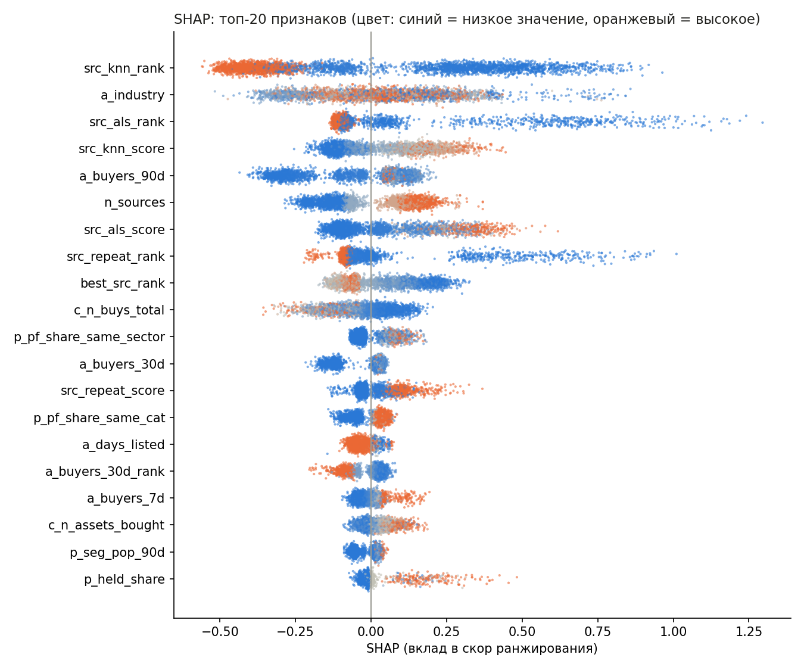
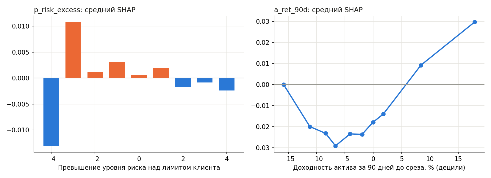
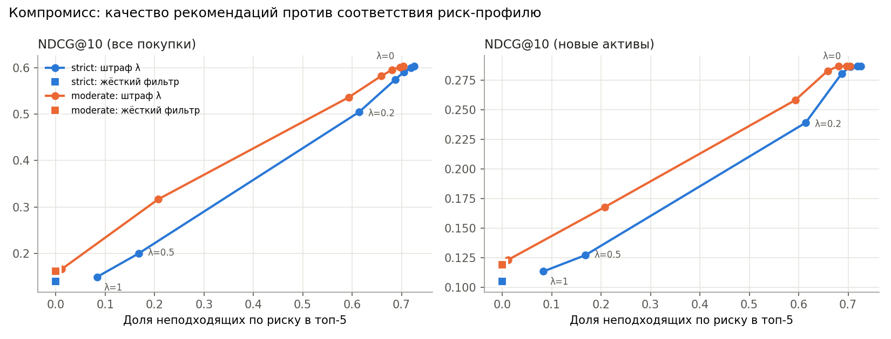
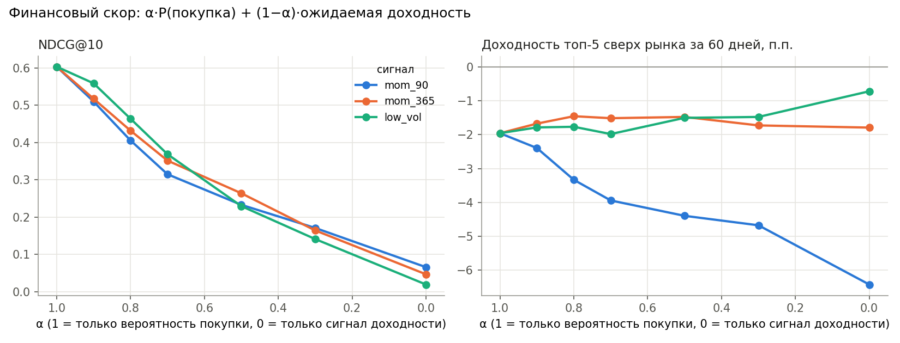
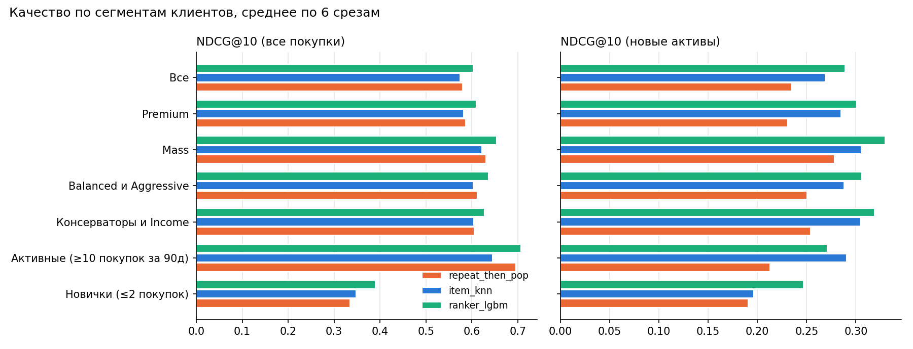

<p align="center">
  <a href="README.md"></a>
  <a href="README.ru.md"></a>
</p>

# FAR-Trans: рекомендации инвестиционных продуктов

Для клиента на дату `t` ранжируем доступные активы (акции, облигации, фонды) так, чтобы наверху были те,
что он купит в ближайшие 60 дней, при этом не нарушая его риск-профиль. Качество меряем тремя группами
метрик: угадывание поведения, финансовый результат, пригодность (suitability).

Данные: [FAR-Trans](https://doi.org/10.5525/gla.researchdata.1658) (Sanz-Cruzado, Droukas, McCreadie, 2024),
реальные сделки клиентов европейского банка 2018–2022, CC BY 4.0. Короткий отчёт для бизнеса: [docs/report.md](docs/report.md).

## Главное

* **Двухуровневая модель** (кандидаты из CF → LightGBM lambdarank) лучше всех бейзлайнов на каждом из 6 тестовых
  срезов: NDCG@10 **0.604** против 0.580, на новых для клиента активах **0.287** против 0.269.
* **По протоколу авторов датасета** Item-kNN даёт nDCG@10 0.353 против 0.340 у лучшего метода статьи (LightGCN),
  ранкер на подмножестве дат 0.345 против 0.335 у kNN и 0.280 у популярности.
* **Соответствие риск-профилю стоит дорого:** клиенты в основном покупают то, что их профилю не подходит,
  полный запрет неподходящих рекомендаций снижает NDCG на ~77%. Кривая компромисса показывает цену каждой политики.
* **«Рекомендовать то, что вырастет» не работает:** популярность не предсказывает доходность, а momentum
  развернулся в 2022 году. Честный отрицательный результат.
* **Найдено и исправлено:** профили клиентов, заполненные задним числом (утечка), снапшот портфелей
  под видом покупок, приостановленные акции, которые выглядели самыми безопасными.

## Структура

```
configs/base.yaml           даты срезов, окна, шкала и политики риска
src/farrec/data.py          загрузка, очистка, as-of выборки
src/farrec/portfolio.py     восстановление портфелей по сделкам
src/farrec/splits.py        срезы по времени, таргет, train/valid/test
src/farrec/risk.py          уровни риска активов 1..7 (по волатильности, как SRRI)
src/farrec/metrics.py       ranking / financial / suitability
src/farrec/baselines.py     простые бейзлайны
src/farrec/cf.py            Item-kNN и ALS
src/farrec/candidates.py    уровень 1: генерация кандидатов
src/farrec/features.py      признаки клиента, актива и пары
src/farrec/ranker.py        уровень 2: LightGBM / CatBoost ранкер
src/farrec/postprocess.py   пересортировка по риску и доходности
src/farrec/evaluate.py      единый протокол оценки
src/farrec/paper_protocol.py  протокол оценки из статьи авторов датасета
scripts/                    запуск экспериментов (см. reproduce.sh)
service/app.py              FastAPI: топ-k рекомендаций для клиента на дату
tests/                      тесты на утечки и юнит-тесты
```

## Запуск

```
pip install -r requirements.txt
# распаковать архив датасета в data/raw/FAR-Trans/
pytest -q
bash scripts/reproduce.sh          # все таблицы и графики, ~1 ч
uvicorn service.app:app --port 8000
```

Пример запроса к сервису:
`GET /recommend?customer_id=DD1E7FA6C74787F13EC7&date=2022-09-15&k=5&policy=strict` возвращает топ-5 с уровнем риска
каждой бумаги, отметкой «покупал раньше», источником рекомендации и числом кандидатов, отброшенных по риску.
Первый запрос на месяц обучает модель (~2 мин), следующие занимают ~9 с.

## Схема эксперимента

* Срезы: первое число каждого месяца. Признаки и кандидаты только из `(-inf, t)`, таргет: покупки в `[t, t+60d)`.
* Для среза оценки `T` модель обучается только на прошлом: valid = последний срез, чьё окно таргета кончается
  до `T` (early stopping), train = 12 срезов, чьи окна кончаются до valid. Без зазора метки train пересекались бы
  с периодом оценки.
* В оценке только клиенты, купившие хоть что-то в окне таргета. Бейзлайны оцениваются на 12 срезах
  (2021-10 … 2022-09), ранкер на 6 (2022-04 … 2022-09) с переобучением на каждом.
* `_new`-метрики: всё, что клиент покупал раньше, скрыто, таргет только первые покупки актива. Это важно,
  потому что **78.5% покупок повторные**.

## Особенности данных

| Что нашёл | Как обработано |
|---|---|
| 2018-01-02: ~35.7k «покупок» за день (обычно 50–300) — выгрузка стартовых портфелей | флаг `isSnapshot`: идут в портфель, но не считаются покупками |
| `transactionID` не уникален (~29k повторов) — совместные счета | дедупликация только по полной строке |
| Риск-профиль бывает `Predicted_*` | префикс снимается, отдельный флаг |
| Профиль клиента не меняется во времени и заполнен задним числом | см. «Утечки» |
| Приостановленные акции с замороженной ценой: волатильность 0 → уровень риска 1, «безопаснее облигаций» (FOLLIE FOLLIE, AEGEK, DIONIC…) | акция с >50% дней без изменения цены получает уровень 7 |
| Продажи больше видимых покупок (история до 2018 не видна) | позиции обрезаются по нулю |
| 89% покупок — акции | учитывается при интерпретации |

## Бейзлайны

Среднее по 12 срезам, в скобках std. Параметры kNN и ALS подобраны только на срезах до теста (`scripts/tune_cf.py`).

| method | NDCG@10 | HR@10 | NDCG@10_new | HR@10_new | Ret@5 (60д) | Unsuit@5 |
|---|---|---|---|---|---|---|
| random | 0.002 | 0.01 | 0.003 | 0.01 | −0.4% | 0.38 |
| pop_30d | 0.308 (0.070) | 0.64 | 0.243 | 0.48 | −1.0% (8.7%) | 0.62 |
| pop_segment_90d | 0.261 | 0.61 | 0.188 | 0.43 | −1.9% | 0.56 |
| momentum_90d | 0.017 | 0.06 | 0.016 | 0.05 | −5.6% (19%) | 0.72 |
| repeat_then_pop | **0.546** (0.045) | **0.81** | 0.239 | 0.47 | −1.3% | 0.66 |
| item_knn | 0.539 (0.050) | 0.81 | **0.281** (0.037) | **0.53** | −1.3% | 0.68 |
| als | 0.540 (0.041) | 0.80 | 0.202 | 0.38 | −1.4% | 0.67 |

* По общему NDCG «свои покупки + популярность» не хуже kNN и ALS: разницу между моделями видно только на новых активах.
* **Один тестовый срез врёт.** На срезе 2022-09 популярность даёт +8.1% за 60 дней, в среднем по 12 срезам −1.0%
  при std 8.7%. Финансовые метрики имеют смысл только по многим срезам.
* Ни один бейзлайн не обгоняет рынок. Momentum хуже всех: выбирает неликвидные бумаги с резкими скачками цены.

## Двухуровневая модель

**Уровень 1, кандидаты** ([candidates.py](src/farrec/candidates.py)): объединение топ-50 из четырёх источников
(свои прошлые покупки, Item-kNN, ALS, популярность), в среднем ~85 активов на клиента.

| топ-N из источника | кандидатов на клиента | полнота (все покупки) | полнота (новые активы) |
|---|---|---|---|
| 20 | 35 | 88–89% | 54–67% |
| **50** | **85** | **97%** | **84–89%** |
| 100 | 155 | 99% | 95–97% |

**Уровень 2, ранжирование** ([ranker.py](src/farrec/ranker.py)): LightGBM lambdarank, группа = (срез, клиент),
68 признаков ([features.py](src/farrec/features.py)): клиент (активность, портфель, профиль), актив (доходности,
волатильность, просадка, популярность и её тренд), пара (держит ли, сколько раз покупал, доля сектора в портфеле,
превышение риска, популярность в риск-сегменте, скоры и ранги источников).

Среднее по 6 срезам (2022-04 … 2022-09), модель лучше бейзлайнов **на каждом** срезе:

| method | NDCG@10 | HR@10 | NDCG@10_new | HR@10_new |
|---|---|---|---|---|
| pop_30d | 0.335 | 0.66 | 0.239 | 0.45 |
| repeat_then_pop | 0.580 | 0.83 | 0.235 | 0.44 |
| item_knn | 0.574 | 0.83 | 0.269 | 0.49 |
| als | 0.570 | 0.82 | 0.188 | 0.34 |
| **ranker_lgbm** | **0.604** | **0.85** | **0.287** | **0.52** |

**CatBoost YetiRank** на 3 последних срезах: NDCG@10 0.590 против 0.588 у LightGBM, на новых активах 0.269 против
0.271, то есть в пределах шума, а обучается примерно в 30 раз дольше (~1 ч против ~2 мин на срез). Основная модель — LightGBM.

## Сравнение со статьёй авторов датасета

Протокол статьи ([paper_protocol.py](src/farrec/paper_protocol.py)) отличается от моего: 61 дата раз в две недели
(2019-08 … 2022-01), окно 6 месяцев, только новые для клиента активы, ROI@10 = среднемесячная доходность
равновзвешенного топ-10. Чтобы убедиться, что протокол воспроизведён, сначала прогнал random: ROI@10 **0.0071**,
ровно как в статье; nDCG@10 0.0098 против 0.0106.

| метод | nDCG@10 | ROI@10 | источник |
|---|---|---|---|
| LightGCN (лучший в статье) | 0.340 | 0.0004 | статья, 61 дата |
| Popularity | 0.271 | 0.0006 | статья, 61 дата |
| UB kNN | 0.160 | 0.0119 | статья, 61 дата |
| **Item-kNN** | **0.353** | −0.0086 | этот проект, те же 61 дата |
| pop_30d | 0.304 | −0.0140 | этот проект, те же 61 дата |

Ранкер переобучается на каждой дате, поэтому его прогнал на 18 месячных датах внутри периода статьи (2020-06 … 2021-11):
**0.345** против 0.335 у Item-kNN (лучше в 15 датах из 18) и 0.280 у популярности. ROI@10 1.42% в месяц при рынке 1.25%.
Отрыв от kNN здесь меньше, чем в основном протоколе: модель учится на 60-дневном таргете с повторными покупками,
а протокол статьи меряет только новые активы за 6 месяцев.

## Что модель выучила (SHAP)



* 47% суммарного |SHAP| дают скоры и ранги источников (kNN, ALS, повторы), 28% признаки актива, по 12–13%
  клиента и пары.
* **Модель выучила «покупают то, что выросло»**: вклад доходности за 90 дней растёт с её величиной, плюс слабый
  эффект покупки на просадке.
* **Риск модели почти безразличен:** средний вклад превышения уровня риска ~0.008 против ~0.35 у ранга kNN.
  Поведение клиентов не учит модель соблюдать профиль, поэтому ограничения накладываются отдельно.



## Риск-профиль: компромисс между качеством и соответствием

Уровень риска актива 1..7 по годовой волатильности (корзины как в SRRI: 0.5/2/5/10/15/25%). Калибровать допустимые
уровни по поведению нельзя: **профиль почти не влияет на покупки**.

| профиль | доля покупок уровня 7 | доля акций |
|---|---|---|
| Conservative | 70% | 75% |
| Income | 79% | 83% |
| Balanced | 82% | 87% |
| Aggressive | 82% | 87% |

Сделки в датасете клиентские (execution-only), а рекомендация — это совет, на который распространяются требования
suitability. Поэтому лимиты задаются политикой ([configs/base.yaml](configs/base.yaml)): `strict` (Conservative ≤3,
Income ≤4, Balanced ≤5, Aggressive ≤7) и `moderate` (+1 уровень для первых трёх профилей).

Пересортировка ([postprocess.py](src/farrec/postprocess.py)): итоговый скор = перцентиль скора модели − λ × превышение
уровня. Жёсткий фильтр выкидывает неподходящие активы и добивает список самыми популярными подходящими.



| strict | NDCG@10 | NDCG@10_new | доля неподходящих в топ-5 |
|---|---|---|---|
| λ = 0 (без ограничений) | 0.604 | 0.287 | 73% |
| λ = 0.1 | 0.574 | 0.280 | 69% |
| λ = 0.2 | 0.504 | 0.239 | 61% |
| λ = 0.5 | 0.200 | 0.127 | 17% |
| жёсткий фильтр | 0.140 | 0.105 | 0% |

* **Бесплатного соответствия нет:** каждая убранная неподходящая рекомендация — это потерянное попадание.
  Полное соблюдение strict-политики стоит ~77% NDCG.
* Кривая не линейная: при λ ≤ 0.1 потеря ~5%, затем обрыв между 0.2 и 0.5.
* Умеренная политика при той же доле нарушений даёт заметно больше качества. Выбор политики — бизнес-решение,
  кривая показывает его цену.

## Финансовый скор: работает ли «рекомендовать то, что вырастет»

Итоговый скор = α × перцентиль P(покупки) + (1 − α) × перцентиль сигнала доходности. Сначала проверил, предсказывают ли
сигналы будущую доходность (rank IC с доходностью за 60 дней, 28 срезов 2020–2022):

| сигнал | средний IC | доля месяцев с IC > 0 |
|---|---|---|
| momentum 90д | +0.081 | 71% |
| momentum 365д | +0.041 | 61% |
| низкая волатильность | −0.090 | 39% |
| популярность за 30д | +0.008 | 43% |



* **Популярность доходность не предсказывает:** люди покупают то, что на слуху, и это не связано с будущим ростом.
* **momentum 90д в 2022 году ухудшает доходность:** при α = 0 рекомендации отстают от рынка на 6.4 п.п. против 2.0 п.п.
  у чистой модели. Сигнал, работавший в среднем за 2020–2022, развернулся.
* momentum 365д даёт +0.5 п.п. при α = 0.8, но NDCG падает с 0.60 до 0.43, а шум доходности между срезами ±7 п.п.
* **Вывод:** на этих данных финансовый скор не работает. Это результат, а не провал эксперимента.

## Качество по сегментам



| сегмент | n | repeat_then_pop | item_knn | ranker | ranker, новые | item_knn, новые |
|---|---|---|---|---|---|---|
| Новички (≤2 покупок) | 268 | 0.334 | 0.348 | **0.390** | **0.247** | 0.196 |
| Активные (≥10 за 90д) | 247 | 0.695 | 0.645 | **0.707** | 0.271 | **0.290** |
| Консерваторы и Income | 588 | 0.606 | 0.604 | **0.627** | **0.319** | 0.305 |
| Все | 1753 | 0.580 | 0.574 | **0.604** | **0.289** | 0.269 |

* Больше всего ранкер выигрывает на новичках: +12% к лучшему бейзлайну, на новых активах +26%.
* У активных клиентов на новых активах kNN лучше ранкера: модель налегает на повторные покупки.

## Утечки, которые нашёл и закрыл

* **Профили клиентов заполнены задним числом.** В 38.5% строк `lastQuestionnaireDate` позже даты самой строки,
  а риск-профиль ни у одного клиента не меняется. Профиль отражает итоговое состояние, а не состояние на дату.
  Признак «дней с последней анкеты» давал отрицательные значения и был убран; риск-профиль используется как
  статичный атрибут (ограничение данных).
* **Снапшот портфелей 2018-01-02 под видом покупок** раздувал бы популярность и таргет.
* Цены только forward-fill, никогда backward-fill (иначе в прошлое попадают будущие цены).
* Кандидаты ограничены активами, у которых была цена до среза.
* `forward_return` использует будущие цены и вызывается только в метриках.
* Обучающие срезы ранкера только такие, у которых окно таргета закончилось до среза оценки.
* Подбор гиперпараметров только на срезах до теста.
* Тест [test_no_leakage.py](tests/test_no_leakage.py): рекомендации и признаки второго уровня на полных данных и на данных,
  обрезанных по дате среза, должны совпадать.

## Ограничения

* Риск-профиль статичен и, вероятно, отражает анкеты после даты среза.
* Уровень риска считается по отдельной бумаге, а не по портфелю: для реального продукта нужна оценка вклада в риск портфеля.
* Таргет — факт покупки. Мы не знаем, что клиенту показывали, поэтому это оценка «угадывания», а не эффекта рекомендаций.
* Тестовый период 2022 года — падающий рынок; финансовые выводы привязаны к режиму рынка.
